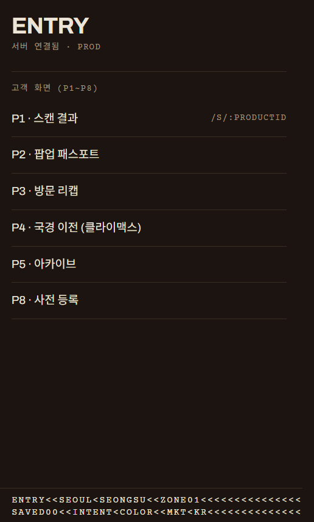
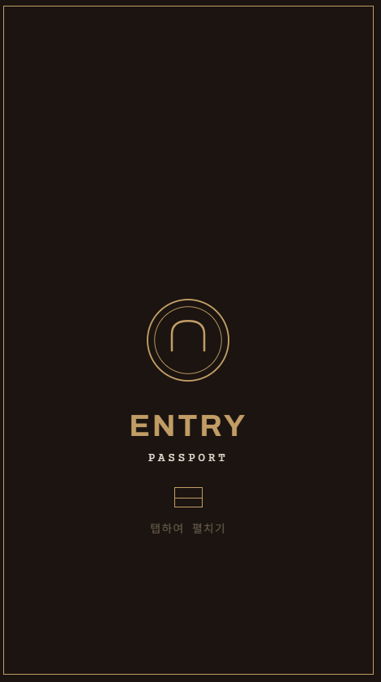
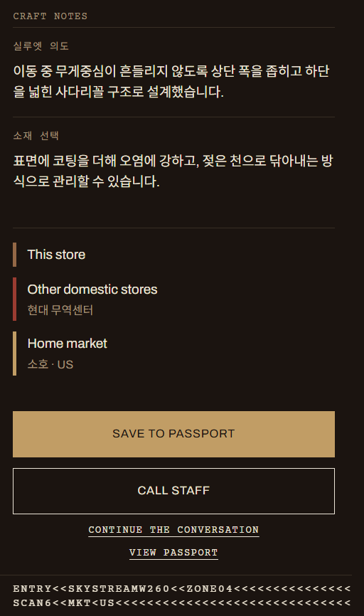
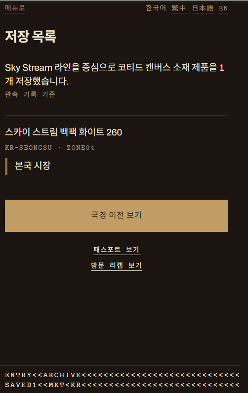
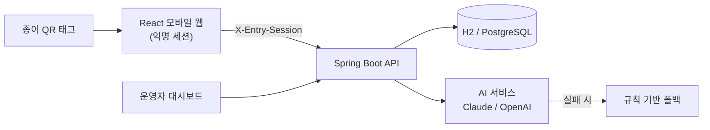

<div align="center">


# ENTRY

**매대 태그를 스캔하면, 로그인 없이 그 순간의 구매 의도가 기록됩니다.**
고객이 어느 나라로 이동하든 — 그 기록은 현지 재고와 채널로 따라갑니다.

[](https://entrypassport.1.201.116.98.sslip.io/)
[](./docs/PRD.md)
[](./docs/pitch-deck/ENTRY_Pitch_Deck.pdf)


멋쟁이사자처럼 McM 트랙 중앙 해커톤 출품작

</div>

---

## 목차

1. [프로젝트 소개](#1-프로젝트-소개)
2. [문제와 해결](#2-문제와-해결)
3. [핵심 기능](#3-핵심-기능)
4. [화면 둘러보기](#4-화면-둘러보기)
5. [AI 활용](#5-ai-활용)
6. [기술 스택과 언어 비율](#6-기술-스택과-언어-비율)
7. [아키텍처](#7-아키텍처)
8. [프로젝트 구조](#8-프로젝트-구조)
9. [시작하기](#9-시작하기)
10. [제품 문서](#10-제품-문서)
11. [팀 · 기여도](#11-팀--기여도)

---

## 1. 프로젝트 소개

**ENTRY**는 오프라인 매장·팝업스토어의 매대에 붙은 **종이 QR 태그** 하나로 시작되는 서비스입니다.
앱 설치도, 회원가입도 없이 모바일 웹에서 스캔하는 순간 **익명 세션**이 만들어지고, 그 순간의 구매 의도가 기록됩니다.

데모의 클라이맥스는 **국경 이전(Border Transfer)** 입니다. 서울에서 본 제품을 홍콩·도쿄·싱가포르로 돌아가서 사고 싶을 때, 저장해 둔 기록이 그대로 따라가 **현지 재고와 채널**로 연결됩니다.

> 브랜드 연동 예시는 MCM 매장(성수·더현대·합정·문래)이며, 캐릭터·카피·컬러는 `brand/` 콘텐츠 레이어로 분리되어 다른 브랜드로 교체할 수 있습니다. 제품명·데이터는 모두 더미입니다.

## 2. 문제와 해결

**문제** — 오프라인 매장은 고객이 무엇을 집어 들었다 내려놓았는지 알 방법이 없습니다. 방문객 대다수는 구매 없이 나가고 그 데이터는 남지 않습니다. 팝업스토어의 경험은 철수와 함께 사라지고, 여행객의 관심은 귀국 후 이어질 채널이 없습니다.

**해결** — 매대 태그 스캔 한 번으로 시작되는 로그인 없는 익명 세션. 보상은 할인이 아니라 **접근 권한**입니다.

## 3. 핵심 기능

| | 기능 | 설명 |
| --- | --- | --- |
| 📷 | **무마찰 스캔** | QR 스캔만으로 제품 정보·제작 배경·실물 재고 확인, 아카이브에 저장 |
| 🛂 | **팝업 패스포트** | 구역을 방문할 때마다 검인(스탬프)이 쌓이고, 체험할수록 높은 열람 권한이 열림 |
| 🌏 | **국경 이전** | 시장(KR/HK/JP/US/SG)을 이동하면 저장한 제품이 현지 재고·채널로 자동 연결 |
| 🗂 | **아카이브 · 리캡** | 방문 기록과 관심 경향을 AI가 요약, 이메일로 다시 돌아오기(`/lookup`) 지원 |
| 💬 | **대화 이어가기** | 캐릭터와 3턴 대화, 어드바이저 브리핑으로 직원 상담 연결 |
| 📊 | **운영자 대시보드** | 어떤 제품이 관심을 받고도 팔리지 않는지, 어느 구역이 저장으로 이어지는지 확인 |
| 🌐 | **4개 언어** | 한국어 · English · 繁體中文 · 日本語 자동 전환 |

**설계 원칙**: 로그인 강제 없음 · 할인/쿠폰 UI 없음 · 위치 추적 없음 · 하드웨어 의존 없음(종이 QR + 모바일 웹) · 실제 PII/결제 미저장

## 4. 화면 둘러보기

모바일 기준 화면(402×874)입니다.

<table>
  <tr>
    <td align="center"><br/><b>홈 · 화면 메뉴</b><br/><sub>여권 MRZ 스타일 하단 바</sub></td>
    <td align="center"><br/><b>P2 · 팝업 패스포트 표지</b><br/><sub>탭하여 펼치기</sub></td>
    <td align="center"><br/><b>P1 · 스캔 결과</b><br/><sub>제작 배경 · 시장별 재고 · 저장</sub></td>
    <td align="center"><br/><b>P5 · 아카이브</b><br/><sub>저장 목록 · 국경 이전 진입</sub></td>
  </tr>
</table>

| 화면 | 경로 | 내용 |
| --- | --- | --- |
| P1 스캔 결과 | `/s/:productId` | 제품 정보, 제작 배경, 재고, 저장 |
| P2 팝업 패스포트 | `/passport` | 검인 도장, 열람 권한 단계 |
| P3 방문 리캡 | `/recap` | 관심 경향 요약, 계정 연결 |
| **P4 국경 이전** | `/transfer` | 저장 목록 → 현지 재고·채널 연결 (**클라이맥스**) |
| P5 아카이브 | `/archive` | 저장한 제품 목록 |
| P6 대화 이어가기 | `/talk/:scanId` | 캐릭터와 3턴 대화 |
| P7 어드바이저 뷰 | `/advisor/:grantToken` | 직원용 브리핑 |
| P8 사전 등록 | `/register` | 사전 등록 |
| D1 / D2 | `/admin`, `/admin/personas` | 운영자 전용(비밀번호 필요) |

> P3·P4 등 나머지 화면은 라이브 데모에서 직접 확인할 수 있습니다.

## 5. AI 활용

AI는 장식이 아닙니다. 아래 지점에서 실제로 호출되며, **실패해도 화면은 항상 규칙 기반 폴백으로 렌더링**됩니다. 프롬프트는 `api/src/main/resources/prompts/*.md`에 분리되어 있습니다.

| ID | 기능 | 화면 | 폴백 |
| --- | --- | --- | --- |
| AI-1 | 구매 의도 신호 분석 | P1 | 규칙 기반 분석기 |
| AI-2 | 캐릭터 인사 · 3턴 대화 | P1, P6 | 규칙 기반 인사 / 고정 안내 |
| — | 관심 경향 요약 | P3, P5 | 규칙 기반 요약 |
| AI-3 | 언어 자동 전환 | 전 화면 | i18n 정적 사전 4종 |
| AI-4 | 국경 이전 메시지 | P4 | 규칙 기반 + 고정 rationale |
| AI-5 | 어드바이저 브리핑 | P7 | 규칙 기반 브리핑 |
| — | 페르소나 시뮬레이션 | D2 | 고정 A/B 결과 |

- Anthropic Messages API 기본, OpenAI Chat Completions 병행 지원 (`entry.ai.provider`)
- **모든 LLM 호출은 Spring 백엔드에서만** — API 키는 프론트엔드에 노출되지 않음
- 타임아웃 8초, 1회 재시도 후 폴백. 개발 중에는 `entry.ai.mock=true`로 토큰 절약

자세한 구현 상태는 [`docs/AI_SPEC.md`](./docs/AI_SPEC.md)를 참고하세요.

## 6. 기술 스택과 언어 비율

| 영역 | 사용 기술 |
| --- | --- |
| **Frontend** | React 19, TypeScript, Vite, Tailwind CSS v4, React Router v7, Zustand, Motion, Recharts |
| **Backend** | Spring Boot 3.3+, Java 21, Gradle (Kotlin DSL), Spring Web / Data JPA / Validation, springdoc-openapi |
| **Database** | H2 (로컬) · PostgreSQL (배포) |
| **AI** | Anthropic Claude, OpenAI (`WebClient`, 백엔드 전용) |
| **Infra** | Docker Compose (nginx + api + postgres), 가비아 클라우드 VM |

**언어 비율** (소스 코드 라인 기준, JSON·Markdown 제외)

| 언어 | 라인 수 | 비율 |
| --- | ---: | ---: |
| Java | 5,184 | 54% |
| TypeScript (TSX) | 3,367 | 35% |
| TypeScript | 863 | 9% |
| CSS | 179 | 2% |

## 7. 아키텍처



- **익명 세션**: 최초 진입 시 `POST /api/v1/sessions`로 UUID 발급 → `localStorage`에 저장. 세션이 없어도 자동 재발급되어 막히는 화면이 없습니다.
- **도메인 중심 패키지**: `scan` `passport` `intent` `transfer` `advisor` `recap` `archive` `persona` `ai` 등

## 8. 프로젝트 구조

```
.
├─ docs/            PRD · AI_SPEC · DESIGN_SYSTEM · API_CONTRACT · 피칭덱 · screenshots
├─ web/             React 프런트엔드
│  └─ src/          app · screens · components · features · brand · i18n · styles
├─ api/             Spring Boot 백엔드
│  └─ src/main/     java/io/entry/<domain> · resources/{prompts,seed}
├─ docker-compose.yml, deploy.sh
├─ BUILD_STEPS.md   구축·배포 단계
└─ CLAUDE.md        코딩·협업 규칙
```

## 9. 시작하기

**요구사항**: Node.js 20+, JDK 21

```bash
git clone https://github.com/tortoiese/bukdu7team.git
cd bukdu7team
npm install
npm --prefix web install
npm run dev
```

`npm run dev`가 웹(`5173`)과 API(`8080`)를 동시에 실행합니다. 로컬은 H2 file DB와 `entry.ai.mock=true`가 기본이라 API 키 없이 동작합니다.

실제 AI를 쓰려면 `.env`에 `ENTRY_AI_MOCK=false`, `ENTRY_AI_PROVIDER=anthropic|openai`와 해당 API 키를 설정하세요. 배포 구성은 [`BUILD_STEPS.md`](./BUILD_STEPS.md)를 참고하세요.

## 10. 제품 문서

- **[`docs/PRD.md`](./docs/PRD.md)** — 제품 정의서 (가장 먼저 읽을 문서)
- [`docs/pitch-deck/ENTRY_Pitch_Deck.pdf`](./docs/pitch-deck/ENTRY_Pitch_Deck.pdf) — IR 피칭덱
- [`docs/AI_SPEC.md`](./docs/AI_SPEC.md) — AI 기능 명세
- [`docs/DESIGN_SYSTEM.md`](./docs/DESIGN_SYSTEM.md) — 시각 규칙
- [`docs/API_CONTRACT.md`](./docs/API_CONTRACT.md) — 프론트/백 API 계약

## 11. 팀 · 기여도

커밋 수 기준 (전체 브랜치, 총 58 커밋)

| 팀원 | 커밋 | 비율 |
| --- | ---: | ---: |
| 이승환 (Leeseunghwan) | 53 | 91% |
| 진웅 (wlsdnd2367) | 2 | 3% |
| SEOO01 | 1 | 2% |
| sce0108-cyber | 1 | 2% |
| 지윤 | 1 | 2% |

**역할**

- 이승환 : 풀스택 & 기획
- 신채은 : 프론트엔드 & 디자인 & 기획
- 박서준 : 백엔드
- 최진웅 : 백엔드

> 커밋 수는 기여도의 한 측면일 뿐이며, 기획·디자인·발표 등 코드 외 기여는 반영되지 않습니다. 상세 수치는 [Contributors 그래프](../../graphs/contributors)에서 확인할 수 있습니다.
